# System diagrams

Flow diagrams of how the service works, for reviewers and new readers. They are a map, not a spec: `docs/spec.md` is the requirement, `SOLUTION.md` is the design and decisions, and the code is the truth.

These diagrams were checked against the code in three read-only review passes by the AI assistant. No person has reviewed them, the system was not run end to end against them, and rendering on GitHub has not been checked. Section 13 is a proposal from `SOLUTION.md` section 8, not a description of built code, so the code audit does not apply to it.

| # | Diagram | Question it answers |
|---|---|---|
| 1 | [System map](#1-system-map) | What runs, and who talks to whom? |
| 2 | [Accepting a payment](#2-accepting-a-payment) | What does `POST /payments` do, and what can it return? |
| 3 | [Worker submit loop](#3-worker-submit-loop) | How does a payment reach Acme exactly once at a time? |
| 4 | [Acme gate](#4-acme-gate-rate-limit-and-circuit-breaker) | How are the 20 per second limit, 401, 429 and outages handled? |
| 5 | [Classifying Acme's POST answer](#5-classifying-acmes-post-answer) | Approved, declined, failed or unknown? |
| 6 | [Status recompute](#6-status-recompute) | How does a payment's status follow from its events? |
| 7 | [Recovery and RTTQ](#7-recovery-and-rttq) | What happens when the outcome is not known? |
| 8 | [Callbacks](#8-callbacks-advice-and-webhook) | How are Payment Advice and webhooks accepted and applied? |
| 9 | [Status lifecycle](#9-status-lifecycle) | Which status moves are possible? |
| 10 | [Crash recovery sequence](#10-crash-recovery-sequence) | What if a worker dies after sending? |
| 11 | [Data model](#11-data-model) | What is stored? |
| 12 | [Daily summary](#12-daily-summary) | How is the settlement figure computed? |
| 13 | [AWS production design](#13-aws-production-design-proposed) | How would this run on AWS? (proposed, not built) |

## 1. System map

Files: `docker-compose.yml`, `src/Payments.Api/Program.cs`, `src/Payments.Worker/Processing/*`.

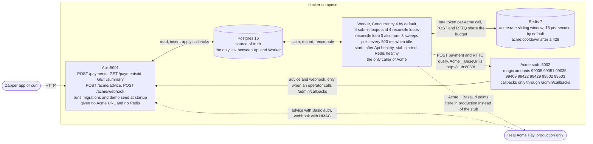

## 2. Accepting a payment

Files: `src/Payments.Api/Endpoints/PaymentEndpoints.cs`, `src/Payments.Application/Payments/PaymentService.cs`, `PostgresPaymentStore.InsertAsync`.

The Api never calls Acme. It validates, writes one `Pending` row and answers. The Worker does the rest.

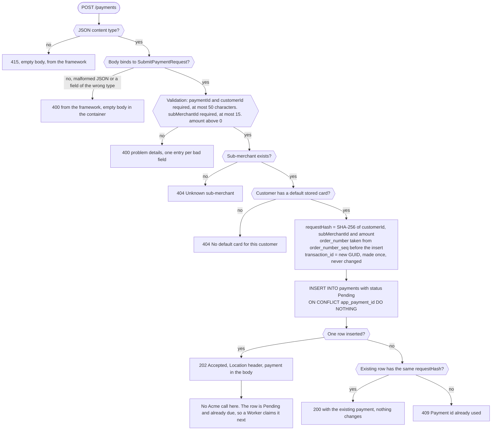

A malformed body is answered by the framework itself. `BadRequestExceptionHandler` only adds a problem-details body when the framework throws `BadHttpRequestException` instead of answering directly, so the body is empty in the container (checked against the running stack). A POST with `-d` quoting broken by the shell lands here.

## 3. Worker submit loop

Files: `src/Payments.Worker/Processing/PaymentSubmissionWorker.cs`, `src/Payments.Application/Payments/PaymentSubmissionService.cs`, claim, release and extend SQL in `PostgresPaymentStore.cs`.

The lease is the Acme timeout (40 s) plus `LeaseMargin` (30 s), so 70 s by default.

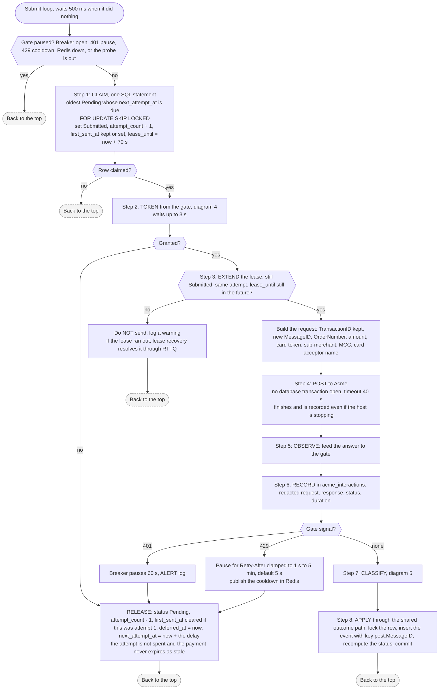

If the gate or the request build throws, the claim is released with no delay, the error is rethrown, and the loop logs it and waits (on shutdown the loop simply exits). If the worker dies after the POST, the lease expires and diagram 7 takes over.

## 4. Acme gate: rate limit and circuit breaker

Files: `src/Payments.Application/Payments/AcmeGate.cs`, `src/Payments.Infrastructure/Acme/RedisAcmeRateLimiter.cs`.

One gate serves both POST and RTTQ calls. The Redis budget is shared by every worker. The breaker state is per process.

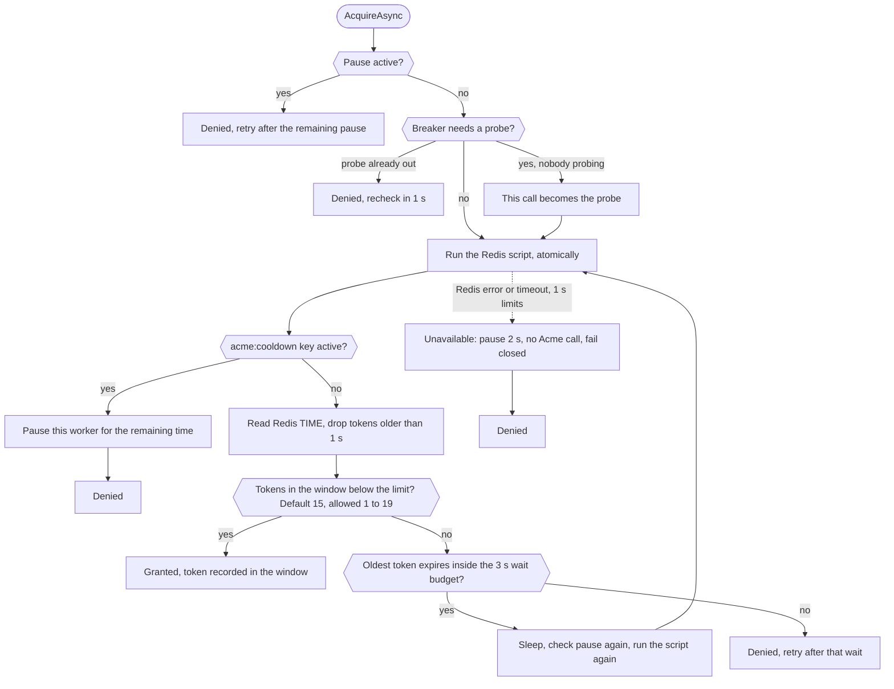

A denied or cancelled probe frees the probe slot, so the next caller may probe.

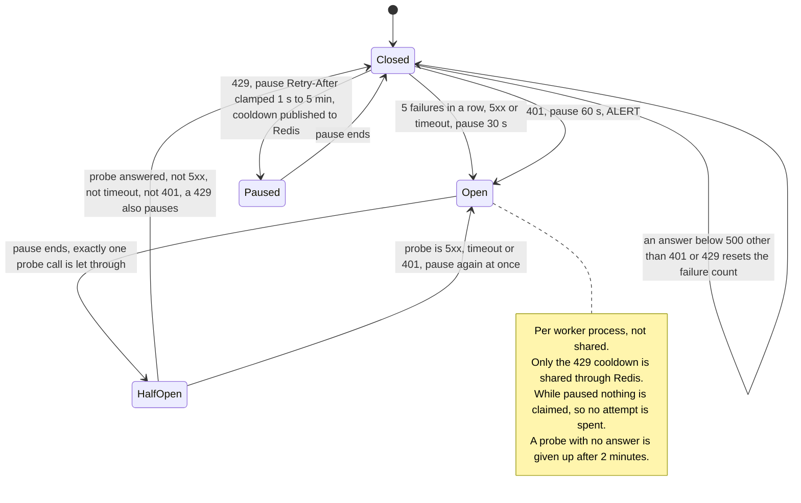

## 5. Classifying Acme's POST answer

File: `src/Payments.Application/Payments/AcmeOutcomeClassifier.cs`.

The outcome is decided by the response code: `Success` with a code other than `00` is a decline. `TransactionStatus` only confirms an approval: code `00` with any status other than `Success` is not approved, it is `OutcomeUnknown`.

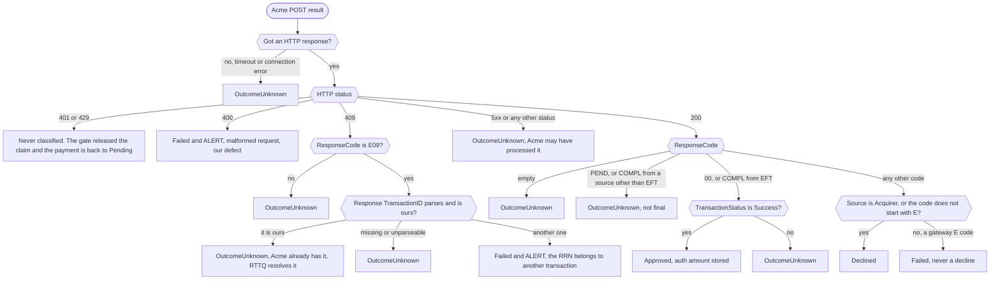

## 6. Status recompute

Files: `src/Payments.Domain/PaymentStatusRules.cs`, `PaymentOutcomeService.Decide`, `PostgresPaymentStore.ApplyEventAsync`.

The status follows from the stored events, so duplicate and out-of-order deliveries converge on the same answer. The one exception is the current status: a `Submitted` payment moves to `Unknown` only when the new event is `OutcomeUnknown`. A flag (`needs_investigation`) is only ever set, never cleared.

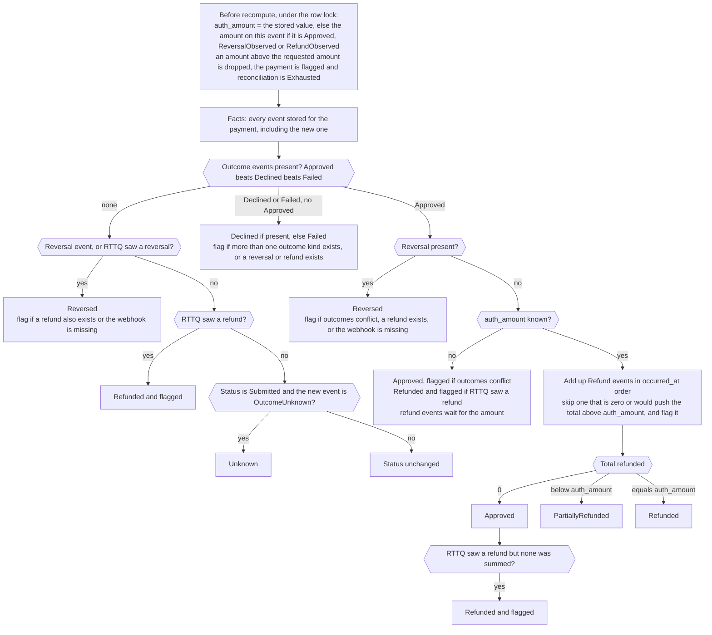

On the Approved path the flag is also set when outcomes conflict, when an over-refund was skipped, or when RTTQ saw a refund or reversal that no webhook has confirmed yet.

## 7. Recovery and RTTQ

Files: `src/Payments.Application/Payments/ReconciliationService.cs`, `RttqClassifier.cs`, `src/Payments.Worker/Processing/ReconciliationWorker.cs`.

RTTQ is the transaction status query. A payment never gets a new `TransactionID`, and silence never makes it `Failed` once it may have been sent.

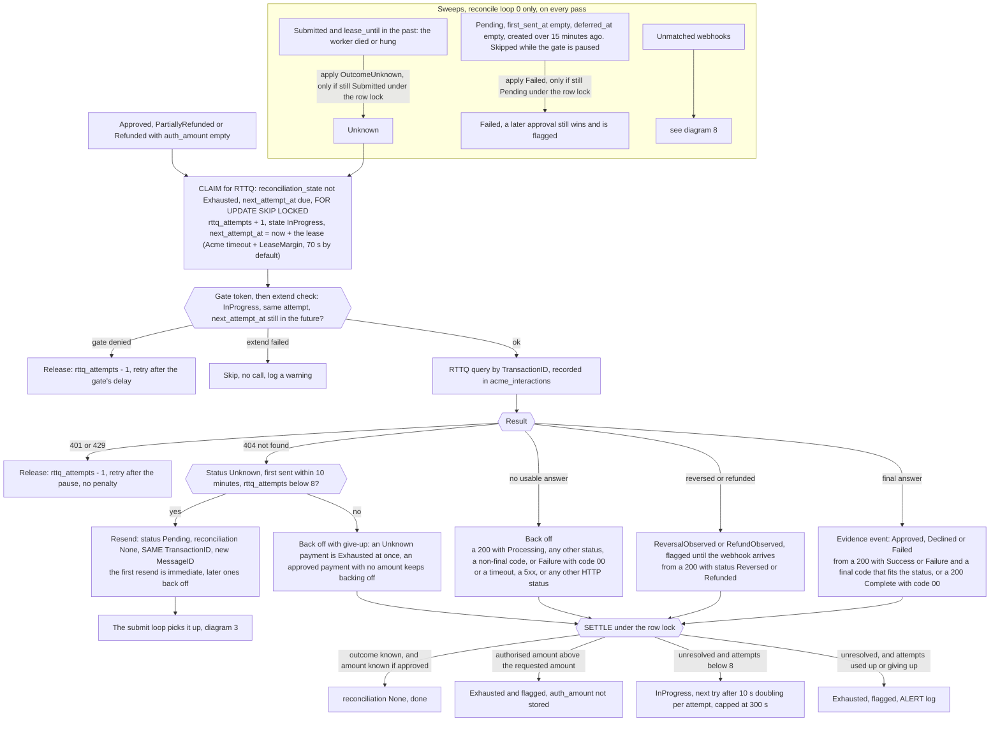

An Exhausted payment keeps its status, is flagged for a person, and is no longer claimed.

## 8. Callbacks: advice and webhook

Files: `src/Payments.Api/Endpoints/CallbackEndpoints.cs`, `src/Payments.Application/Payments/CallbackService.cs`, `ReconciliationService.AdoptUnmatchedWebhooksAsync`.

The advice is matched to a payment by `TransactionID`. The webhook is matched by `order_number`, which is the webhook's `rrn`. Only webhooks go through the late sweep: an unmatched advice is recovered by RTTQ.

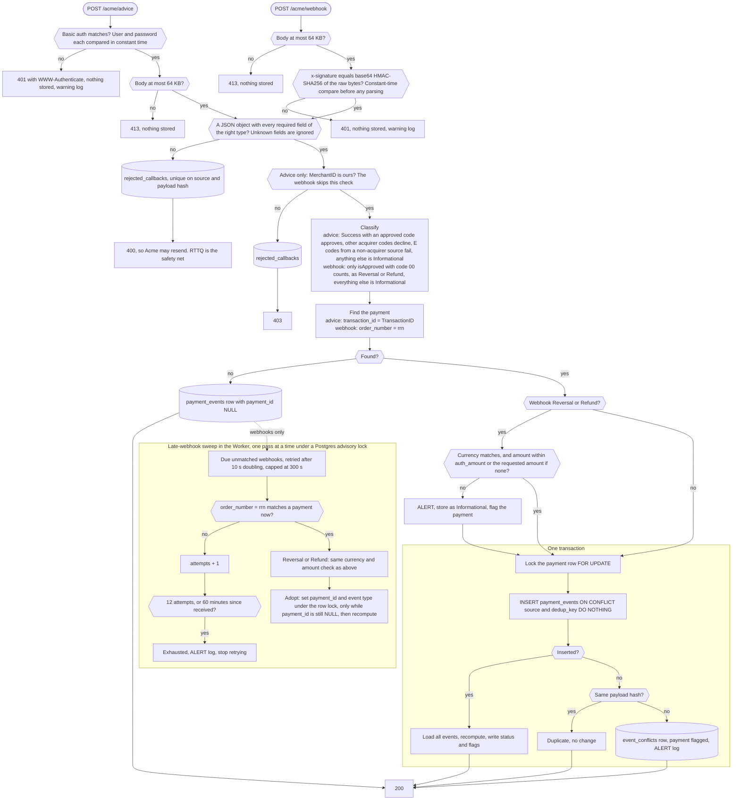

Dedup keys: advice is `TransactionID|RequestType|TransactionStatus|ResponseCode`, webhook is `transactionUUID`.

| Situation | Answer |
|---|---|
| Bad Basic credentials or bad signature | 401 |
| Body over 64 KB | 413 |
| Missing or invalid field, or non-JSON | 400, body kept in `rejected_callbacks` |
| Advice for another merchant | 403, body kept in `rejected_callbacks` |
| Applied, duplicate, conflict or unmatched | 200 |

## 9. Status lifecycle

Files: `PaymentStatusRules.cs`, `AcmeOutcomeClassifier.cs`, `ReconciliationService.cs`. These are the main moves, not every combination the recompute allows.

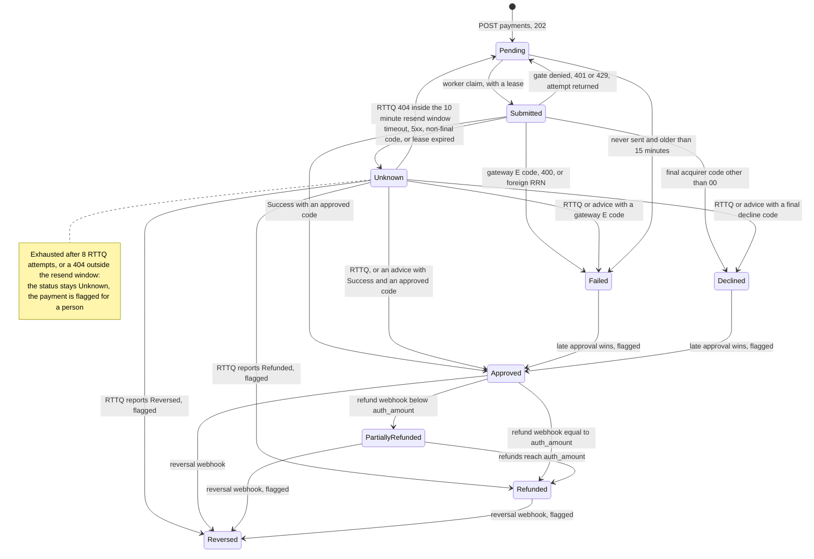

## 10. Crash recovery sequence

A crash after the POST never leads to a second payment under a new `TransactionID`: a resend reuses the same `TransactionID`, and only after RTTQ says Acme has no record of it.

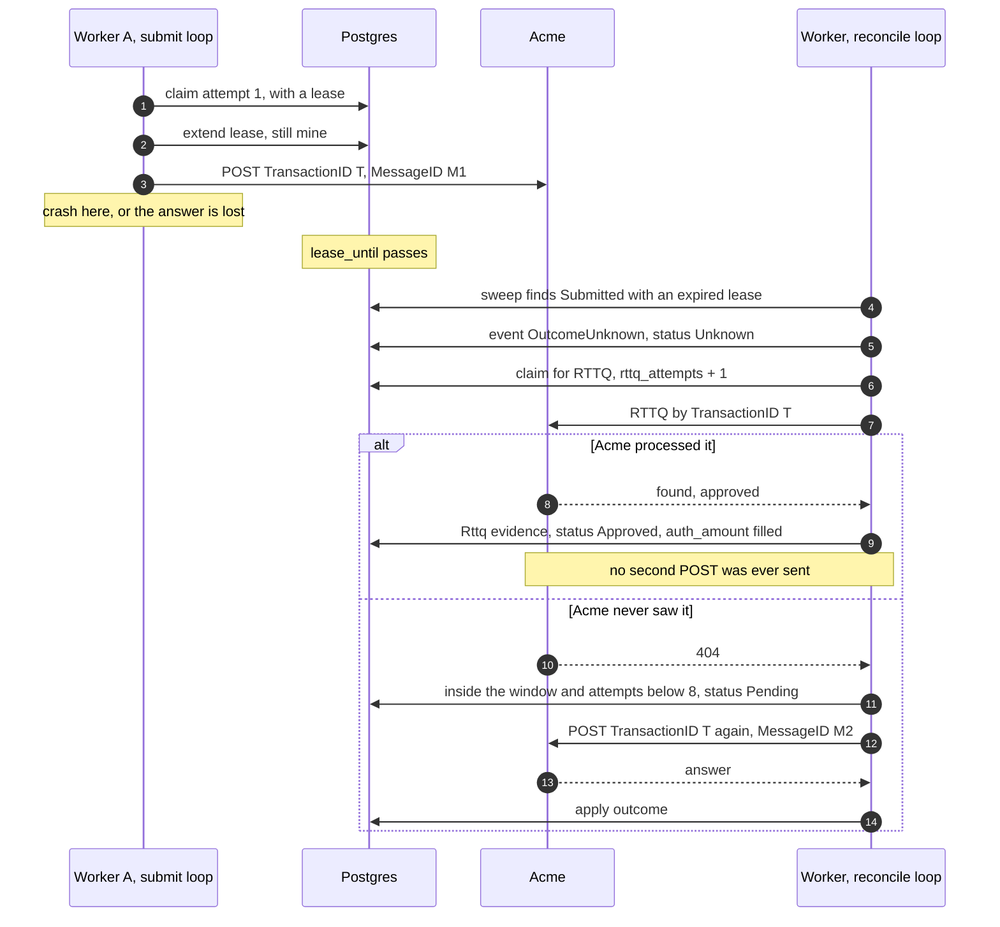

In the 404 branch the resend is sent by a submit loop that claims the `Pending` row. It is drawn on one lifeline to keep the picture short.

## 11. Data model

Files: `src/Payments.Infrastructure/Schema/v1/V1_00` to `V1_06`. Only the columns that matter to the flows are listed.

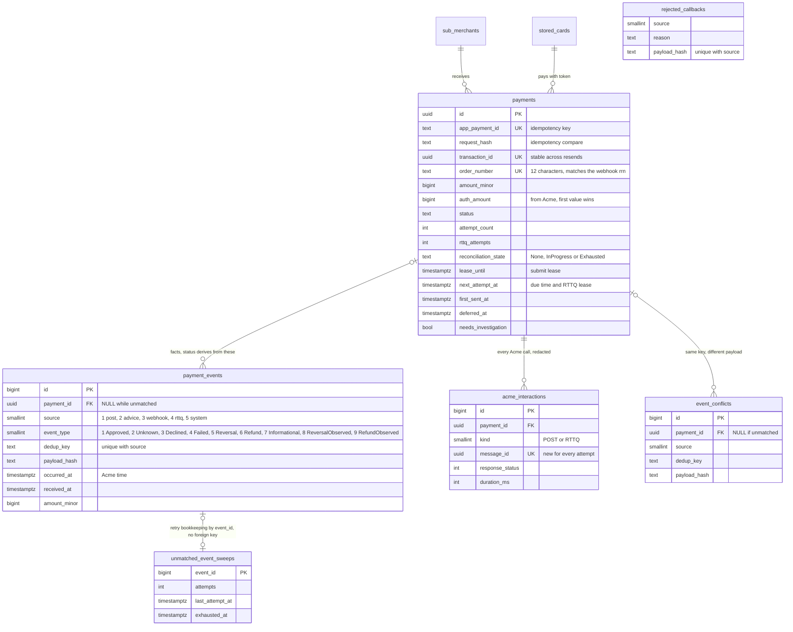

`rejected_callbacks` has no `payment_id` column, so it is not linked to `payments`.

## 12. Daily summary

Files: `sql/daily-summary.sql`, `src/Payments.Application/Payments/DailySummary.cs`, `src/Payments.Api/Endpoints/SummaryEndpoints.cs`.

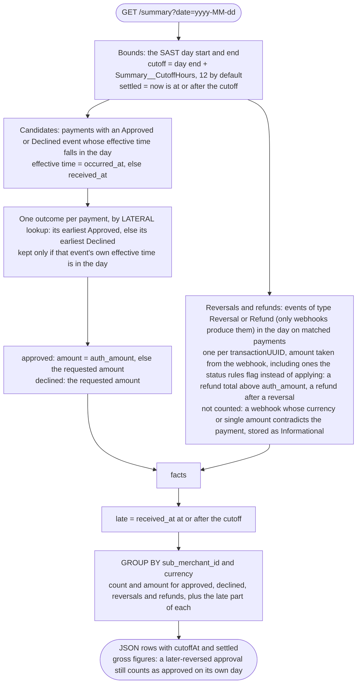

The SQL counts every stored `Reversal` and `Refund` event in the day. Two of the rules in the diagram are kept by the code that stores events, not by the query. "One per `transactionUUID`" comes from the unique key on `payment_events` (`source`, `dedup_key`). "Not counted" for a contradicting webhook comes from the callback code storing it as `Informational` instead of as a `Reversal` or `Refund`.

## 13. AWS production design (proposed)

Source: `SOLUTION.md` section 8. **This is a proposal, not built.** What exists today is the application and its failure behaviour (leases, RTTQ recovery, the shared limiter, graceful shutdown, JSON logs, secrets from environment variables). The AWS infrastructure, caller auth on the app API, TLS and metrics do not exist in the repository.

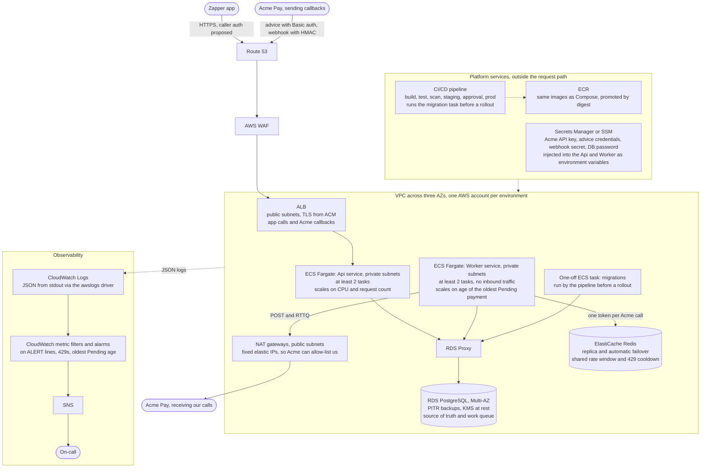

Notes on the picture:

- The Api has no Redis access and never calls Acme, as in the local build (diagram 1). Only the Worker reaches Redis and goes out through NAT.
- Adding Workers never exceeds Acme's limit, because the budget lives in Redis (diagram 4).
- RDS Proxy is there for connection management. Each Api and Worker task has its own Npgsql pool, so autoscaling multiplies connections against Postgres' limit (a burst once gave `53300 too many clients already`, see `SOLUTION.md` section 13). The code caps each process's pool at 40, which is enough for a few tasks. The proxy pools connections as tasks grow and keeps them open through a Multi-AZ failover. It is optional at two tasks per service. The worker's advisory lock is transaction-level, so it works through the proxy; a session-level lock would pin the connection.
- VPC endpoints for ECR, S3, Secrets Manager and CloudWatch keep that traffic off the internet. Each service has its own IAM task role, and the Api and Worker use separate database roles. These are left out of the picture for readability.
- Migrations run as the one-off task, not at Api startup. The code still migrates at startup by default (`Database__MigrateOnStartup` is true), so this is a change the AWS design would make.
- Stop timeout: ECS `stopTimeout` must exceed the worker's host shutdown timeout (Acme timeout + 15 s, 55 s by default).

| Failure | What happens | Built? |
|---|---|---|
| Worker killed or scaled in | SIGTERM: stop claiming, finish the in-flight Acme call. A hard kill leaves an expiring lease, which RTTQ resolves with no blind resend | Yes, in the code |
| Postgres failover | Leases expire, RTTQ resolves them. No payment is lost | Yes, in the code |
| Redis down | The first failed limiter call pauses that worker for 2 s at a time, so it claims nothing while paused. A payment claimed just before the failure is released with no attempt spent. Payment state stays in Postgres | Yes, in the code |
| Acme outage | The breaker opens, nothing is claimed, payments wait in `Pending` | Yes, in the code |
| Loss of an AZ | Multi-AZ RDS and tasks in each AZ continue after a failover of a minute or two | Proposed |
| Bad deploy | Rolling or blue/green, rollback on a failed health check or alarm | Proposed |
